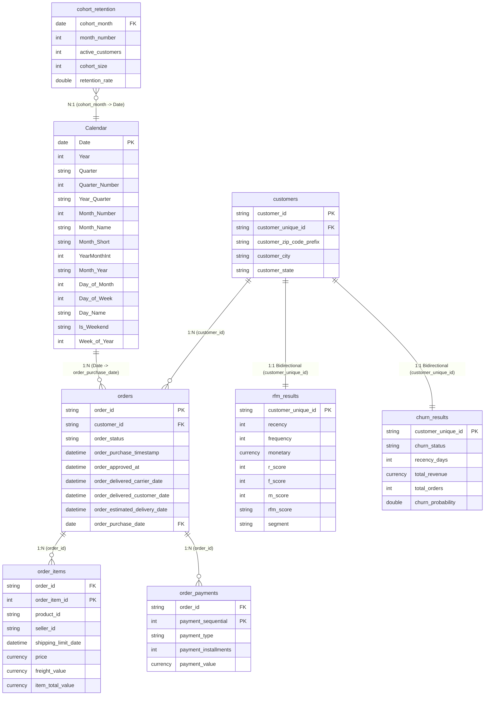

# Data Model Architecture & Schema Documentation — E-Commerce Customer Analytics

This document details the architectural design, entity relationships, schema patterns, column dictionaries, and calculation logic powering the **E-Commerce Customer Analytics & Retention Intelligence** Power BI model.

---

## Table of Contents
1. [Entity Relationship (ER) Diagram](#1-entity-relationship-er-diagram)
2. [Data Model Architecture & Star Schema Design](#2-data-model-architecture--star-schema-design)
   - [Why Star Schema in Power BI?](#why-star-schema-in-power-bi)
   - [Fact Tables vs Dimension Tables](#fact-tables-vs-dimension-tables)
   - [Model Granularity Matrix](#model-granularity-matrix)
3. [Table & Column-Level Data Dictionary](#3-table--column-level-data-dictionary)
   - [Table: `orders`](#table-orders)
   - [Table: `customers`](#table-customers)
   - [Table: `order_items`](#table-order_items)
   - [Table: `order_payments`](#table-order_payments)
   - [Table: `rfm_results`](#table-rfm_results)
   - [Table: `churn_results`](#table-churn_results)
   - [Table: `cohort_retention`](#table-cohort_retention)
   - [Table: `Calendar`](#table-calendar)
4. [Master Key Measures Catalog](#4-master-key-measures-catalog)
5. [Calculated Columns Documentation](#5-calculated-columns-documentation)
   - [Calculated Columns vs DAX Measures: Best Practice Rules](#calculated-columns-vs-dax-measures-best-practice-rules)
   - [Detailed Column Definitions](#detailed-column-definitions)

---

## 1. Entity Relationship (ER) Diagram

The diagram below represents the exact tables, primary keys (PK), foreign keys (FK), cardinalities, and relationship filter directions implemented in Power BI Desktop.



### Relationship Configuration Summary Table

| Relationship ID | From (Many Side) | From Key Column | To (One Side) | To Key Column | Cardinality | Filter Direction | Active | Role in Model |
| :--- | :--- | :--- | :--- | :--- | :--- | :--- | :--- | :--- |
| **REL-01** | `orders` | `order_purchase_date` | `Calendar` | `Date` | Many-to-One (`*:1`) | Single (`Calendar` -> `orders`) | Yes | Drives all Time Intelligence, YTD, MoM, and Date Range Slicers. |
| **REL-02** | `orders` | `customer_id` | `customers` | `customer_id` | Many-to-One (`*:1`) | Single (`customers` -> `orders`) | Yes | Propagates customer geographic attributes (State, City) to orders. |
| **REL-03** | `order_items` | `order_id` | `orders` | `order_id` | Many-to-One (`*:1`) | Single (`orders` -> `order_items`) | Yes | Bridges orders to individual products, prices, and seller details. |
| **REL-04** | `order_payments` | `order_id` | `orders` | `order_id` | Many-to-One (`*:1`) | Single (`orders` -> `order_payments`) | Yes | Links financial transactions and split tender to core orders. |
| **REL-05** | `rfm_results` | `customer_unique_id` | `customers` | `customer_unique_id` | One-to-One (`1:1`) | Both (Bidirectional) | Yes | Enables direct slicing of transactional sales by RFM segment. |
| **REL-06** | `churn_results` | `customer_unique_id` | `customers` | `customer_unique_id` | One-to-One (`1:1`) | Both (Bidirectional) | Yes | Enables direct slicing of sales and customer metrics by Churn Status. |
| **REL-07** | `cohort_retention` | `cohort_month` | `Calendar` | `Date` | Many-to-One (`*:1`) | Single | Inactive* | Allows optional temporal filtering of cohort acquisition batches. |

*\*Note*: `cohort_retention` operates primarily as a standalone analytical lifecycle mart for matrix visualization.

---

## 2. Data Model Architecture & Star Schema Design

### Why Star Schema in Power BI?
Power BI's underlying columnar calculation engine (**VertiPaq**) is engineered specifically for Star Schemas. Adhering to Star Schema principles yields major benefits:
1. **Optimal Columnar Compression**: VertiPaq uses run-length encoding (RLE), dictionary encoding, and bit-packing. Denormalizing wide attributes into dimensions and isolating numeric keys in narrow facts maximizes memory compression.
2. **Deterministic Filter Propagation**: Single-direction filter flow from 1-side dimensions (`Calendar`, `customers`) down to `*`-side facts (`orders`, `order_items`, `order_payments`) guarantees unambiguous DAX context transition.
3. **Minimized Query Ambiguity**: Eliminates circular relationship loops and synthetic cross-joins commonly triggered by complex snowflake structures.

### Fact Tables vs Dimension Tables

#### Fact Tables (Numerical Measurements & Events)
- **`orders`**: Transaction header fact. Grain: *One row per submitted order*. Captures milestone timestamps and fulfillment progression.
- **`order_items`**: Line item fact. Grain: *One row per physical item contained in an order*. Captures unit prices, freight charges, and catalog IDs.
- **`order_payments`**: Settlement transaction fact. Grain: *One row per payment installment or tender split*. Captures collected cash value.

#### Dimension Tables (Descriptive Context & Entities)
- **`customers`**: Primary entity dimension. Grain: *One row per order-customer token*, mapping to persistent `customer_unique_id`.
- **`Calendar`**: Standard conform dimension. Grain: *One row per discrete calendar day*. Provides contiguous dates essential for DAX time-intelligence functions (`DATEADD`, `TOTALYTD`, `DATESINPERIOD`).

#### Analytical / Derived Dimensions
- **`rfm_results`**: Segment mart computed from customer historical orders. Grain: *One row per unique customer*. Contains RFM scores and actionable segment tiers.
- **`churn_results`**: Retention risk mart. Grain: *One row per unique customer*. Contains classification flags (`Active`, `At Risk`, `Churned`) and dormancy counters.
- **`cohort_retention`**: Longitudinal retention mart. Grain: *One row per cohort acquisition month and lifecycle offset month index (0 to 12+)*.

### Model Granularity Matrix

| Table Name | Schema Role | Entity / Event Grain | Approximate Row Count | Compression Tier |
| :--- | :--- | :--- | :--- | :--- |
| `orders` | Transaction Fact | 1 row per order | ~99,441 | High (Dictionary) |
| `order_items` | Transaction Line Fact | 1 row per item within an order | ~112,650 | High (RLE on order_id) |
| `order_payments` | Transaction Settlement Fact | 1 row per payment split | ~103,886 | High (RLE on order_id) |
| `customers` | Entity Dimension | 1 row per customer transaction token | ~99,441 | Medium (Unique hashes) |
| `rfm_results` | Analytical Dimension | 1 row per unique customer | ~96,096 | High (Discrete scores) |
| `churn_results` | Analytical Dimension | 1 row per unique customer | ~96,096 | High (3 status values) |
| `cohort_retention` | Analytical Mart | 1 row per cohort-month pair | ~250 | Maximum (< 10 KB) |
| `Calendar` | Conformed Dimension | 1 row per day (2016-2018) | ~1,095 | Maximum (< 20 KB) |

---

## 3. Table & Column-Level Data Dictionary

### Table: `orders`
- **Description**: Stores high-level order metadata, progression timestamps, and lifecycle status for all placed orders.
- **Source**: `exports/orders.csv`
- **Storage Mode**: Import (VertiPaq)

| Column Name | Storage Type | Power BI Data Type | Nullable | Role | Description | Sample Value |
| :--- | :--- | :--- | :--- | :--- | :--- | :--- |
| `order_id` | String | Text | No | PK | Globally unique 32-character hexadecimal identifier for the order. | `e481f51cbdc54678b7cc49136f2d6af7` |
| `customer_id` | String | Text | No | FK | Foreign key pointing to `customers[customer_id]`. | `9ef44fb54ee1f349090fb34656accf8f` |
| `order_status` | String | Text | No | Attribute | Fulfillment status (`delivered`, `shipped`, `canceled`, `invoiced`, `processing`). | `delivered` |
| `order_purchase_timestamp` | DateTime | Date/Time | No | Attribute | Exact timestamp when customer completed checkout. | `2017-10-02 10:56:33` |
| `order_approved_at` | DateTime | Date/Time | Yes | Attribute | Timestamp when payment clearance was confirmed. | `2017-10-02 11:07:15` |
| `order_delivered_carrier_date` | DateTime | Date/Time | Yes | Attribute | Timestamp when order was handed to logistics carrier. | `2017-10-04 19:55:00` |
| `order_delivered_customer_date` | DateTime | Date/Time | Yes | Attribute | Timestamp when package reached the buyer. | `2017-10-10 21:25:13` |
| `order_estimated_delivery_date` | DateTime | Date/Time | No | Attribute | Target delivery date communicated at checkout. | `2017-10-18 00:00:00` |
| `order_purchase_date` | Date | Date | No | FK | Extracted calendar date of purchase; joins to `Calendar[Date]`. | `2017-10-02` |

---

### Table: `customers`
- **Description**: Customer entity registry providing geographical attributes and bridging order sessions to persistent identity tokens.
- **Source**: `exports/customers.csv`
- **Storage Mode**: Import (VertiPaq)

| Column Name | Storage Type | Power BI Data Type | Nullable | Role | Description | Sample Value |
| :--- | :--- | :--- | :--- | :--- | :--- | :--- |
| `customer_id` | String | Text | No | PK | Single-order customer session token; joins to `orders[customer_id]`. | `9ef44fb54ee1f349090fb34656accf8f` |
| `customer_unique_id` | String | Text | No | FK / AK | Persistent unique customer identifier spanning repeat purchases across time. | `7c396fd4830fd04220f3174f41ce3ed6` |
| `customer_zip_code_prefix` | String | Text | No | Attribute | 5-digit postal code prefix of customer address. | `03176` |
| `customer_city` | String | Text | No | Attribute | Normalized city name (Proper Casing applied). | `Sao Paulo` |
| `customer_state` | String | Text | No | Attribute | 2-letter uppercase Brazilian state code (e.g., `SP`, `RJ`, `MG`). | `SP` |

---

### Table: `order_items`
- **Description**: Contains granular transaction lines linking orders to catalog items, merchant sellers, prices, and shipping fees.
- **Source**: `exports/order_items.csv`
- **Storage Mode**: Import (VertiPaq)

| Column Name | Storage Type | Power BI Data Type | Nullable | Role | Description | Sample Value |
| :--- | :--- | :--- | :--- | :--- | :--- | :--- |
| `order_id` | String | Text | No | FK | Foreign key pointing to `orders[order_id]`. | `00010242fe8c596d1eb5c88fa57c9c05` |
| `order_item_id` | Integer | Whole Number | No | Composite PK | Sequential item index within the order (1, 2, 3...). | `1` |
| `product_id` | String | Text | No | Attribute | Unique identifier of the purchased catalog product. | `4244733e06e7ecb49c54057ccd64f525` |
| `seller_id` | String | Text | No | Attribute | Unique identifier of the fulfilling merchant seller. | `48436dade18acb08ebf718f70276d37b` |
| `shipping_limit_date` | DateTime | Date/Time | No | Attribute | Seller fulfillment deadline before carrier handover. | `2017-09-19 09:45:35` |
| `price` | Decimal | Fixed Decimal (Currency)| No | Measure Base | Item retail price excluding shipping fee. | `$58.90` |
| `freight_value` | Decimal | Fixed Decimal (Currency)| No | Measure Base | Freight / shipping fee charged for this item. | `$13.29` |
| `item_total_value` | Decimal | Fixed Decimal (Currency)| No | Derived | Calculated sum of `price` + `freight_value`. | `$72.19` |

---

### Table: `order_payments`
- **Description**: Captures financial transaction methods, installment counts, and monetary settlement amounts.
- **Source**: `exports/order_payments.csv`
- **Storage Mode**: Import (VertiPaq)

| Column Name | Storage Type | Power BI Data Type | Nullable | Role | Description | Sample Value |
| :--- | :--- | :--- | :--- | :--- | :--- | :--- |
| `order_id` | String | Text | No | FK | Foreign key pointing to `orders[order_id]`. | `b81ef226f3fe1789b1e8b2acac839d17` |
| `payment_sequential`| Integer | Whole Number | No | Composite PK | Sequence index of payment method (e.g. 1st card, 2nd voucher). | `1` |
| `payment_type` | String | Text | No | Attribute | Standardized payment instrument (`Credit Card`, `Boleto`, `Voucher`, `Debit Card`).| `Credit Card` |
| `payment_installments`| Integer| Whole Number | No | Attribute | Number of credit installments selected by the customer. | `8` |
| `payment_value` | Decimal | Fixed Decimal (Currency)| No | Measure Base | Monetary value settled via this payment sequence. | `$99.33` |

---

### Table: `rfm_results`
- **Description**: Analytical customer segmentation mart detailing Recency, Frequency, Monetary metrics and assigned RFM segments.
- **Source**: `exports/rfm_results.csv`
- **Storage Mode**: Import (VertiPaq)

| Column Name | Storage Type | Power BI Data Type | Nullable | Role | Description | Sample Value |
| :--- | :--- | :--- | :--- | :--- | :--- | :--- |
| `customer_unique_id`| String | Text | No | PK / FK | Joins `1:1` to `customers[customer_unique_id]`. | `871766c5855e863f6eccc05f988b23cb` |
| `recency` | Integer | Whole Number | No | Metric | Days elapsed between customer's most recent purchase and analysis date. | `14` |
| `frequency` | Integer | Whole Number | No | Metric | Total lifetime count of delivered orders placed by customer. | `2` |
| `monetary` | Decimal | Fixed Decimal (Currency)| No | Metric | Total lifetime gross revenue generated by customer. | `$218.70` |
| `r_score` | Integer | Whole Number | No | Score | Quintile score for Recency (1 = dormant, 5 = recent). | `5` |
| `f_score` | Integer | Whole Number | No | Score | Quintile score for Frequency (1 = single order, 5 = frequent).| `4` |
| `m_score` | Integer | Whole Number | No | Score | Quintile score for Monetary spend (1 = low, 5 = high spend). | `4` |
| `rfm_score` | String | Text | No | Attribute | Concatenated string score (e.g. `"544"`). | `544` |
| `segment` | String | Text | No | Attribute | Assigned customer segment (e.g. `Champions`, `Loyal Customers`, `At Risk`). | `Champions` |

---

### Table: `churn_results`
- **Description**: Retention intelligence mart classifying customer churn status, inactivity thresholds, and financial exposure.
- **Source**: `exports/churn_results.csv`
- **Storage Mode**: Import (VertiPaq)

| Column Name | Storage Type | Power BI Data Type | Nullable | Role | Description | Sample Value |
| :--- | :--- | :--- | :--- | :--- | :--- | :--- |
| `customer_unique_id`| String | Text | No | PK / FK | Joins `1:1` to `customers[customer_unique_id]`. | `871766c5855e863f6eccc05f988b23cb` |
| `churn_status` | String | Text | No | Attribute | Retention category (`Active`, `At Risk`, `Churned`). | `Active` |
| `recency_days` | Integer | Whole Number | No | Metric | Days since last recorded purchase. | `14` |
| `total_revenue` | Decimal | Fixed Decimal (Currency)| No | Metric | Aggregate historical spend of this customer. | `$218.70` |
| `total_orders` | Integer | Whole Number | No | Metric | Aggregate lifetime orders placed. | `2` |
| `churn_probability` | Double | Decimal Number | No | Metric | Machine learning or heuristic churn probability score (0.0 to 1.0).| `0.12` |

---

### Table: `cohort_retention`
- **Description**: Aggregated cohort lifecycle matrix tracking monthly customer retention rates over 12+ months post-acquisition.
- **Source**: `exports/cohort_retention.csv`
- **Storage Mode**: Import (VertiPaq)

| Column Name | Storage Type | Power BI Data Type | Nullable | Role | Description | Sample Value |
| :--- | :--- | :--- | :--- | :--- | :--- | :--- |
| `cohort_month` | Date | Date | No | Dimension Key| First calendar day of customer's initial acquisition month. | `2017-01-01` |
| `month_number` | Integer | Whole Number | No | Dimension Key| Months elapsed since acquisition (0 = baseline, 1 = +1 month, ...). | `1` |
| `active_customers` | Integer | Whole Number | No | Metric | Distinct customers from cohort who purchased in month `month_number`.| `3` |
| `cohort_size` | Integer | Whole Number | No | Metric | Baseline customer volume acquired in Month 0. | `764` |
| `retention_rate` | Double | Percentage (`0.0%`) | No | Metric | Ratio of `active_customers` to `cohort_size` (e.g. `0.0039` = 0.39%). | `0.0039` |

---

### Table: `Calendar`
- **Description**: Conformed enterprise date dimension generated via Power Query M script, providing contiguous chronological tracking.
- **Source**: Power Query Generated (`List.Dates`)
- **Storage Mode**: Import (VertiPaq)

| Column Name | Storage Type | Power BI Data Type | Nullable | Role | Description | Sample Value |
| :--- | :--- | :--- | :--- | :--- | :--- | :--- |
| `Date` | Date | Date | No | PK | Primary date key (continuous, no missing dates). | `2017-10-02` |
| `Year` | Integer | Whole Number | No | Attribute | 4-digit calendar year. | `2017` |
| `Quarter Number` | Integer | Whole Number | No | Sort Key | Numeric calendar quarter (1 to 4). | `4` |
| `Quarter` | String | Text | No | Attribute | Calendar quarter label (sorted by `Quarter Number`). | `Q4` |
| `Year-Quarter` | String | Text | No | Attribute | Combined year and quarter label (e.g. `2017-Q4`). | `2017-Q4` |
| `Month Number` | Integer | Whole Number | No | Sort Key | Numeric month index (1 to 12). | `10` |
| `Month Name` | String | Text | No | Attribute | Full English month name (sorted by `Month Number`). | `October` |
| `Month Short` | String | Text | No | Attribute | 3-letter abbreviated month name (sorted by `Month Number`). | `Oct` |
| `YearMonthInt` | Integer | Whole Number | No | Sort Key | Integer compound date key `YYYYMM` (sorted key for `Month-Year`).| `201710` |
| `Month-Year` | String | Text | No | Attribute | Display string `MMM YYYY` (sorted by `YearMonthInt`). | `Oct 2017` |
| `Day of Month` | Integer | Whole Number | No | Attribute | Day index within the calendar month (1 to 31). | `2` |
| `Day of Week` | Integer | Whole Number | No | Sort Key | ISO numeric weekday index (1 = Monday, 7 = Sunday). | `1` |
| `Day Name` | String | Text | No | Attribute | Full weekday name. | `Monday` |
| `Is Weekend` | String | Text | No | Attribute | Flag indicating whether day is `"Weekend"` or `"Weekday"`. | `Weekday` |
| `Week of Year` | Integer | Whole Number | No | Attribute | ISO calendar week index (1 to 53). | `40` |

---

## 4. Master Key Measures Catalog

Below is the consolidated matrix of all primary DAX business calculations defined in `_Measures`:

| Measure Name | Business Purpose | Format String | DAX Logic Summary |
| :--- | :--- | :--- | :--- |
| **Total Revenue** | Aggregate delivered sales | `$#,##0.00` | `SUMX(FILTER(order_payments, RELATED(orders[order_status]) = "delivered"), order_payments[payment_value])` |
| **Total Orders** | Unique orders count | `#,##0` | `DISTINCTCOUNT(orders[order_id])` |
| **Total Customers** | Unique individuals count | `#,##0` | `DISTINCTCOUNT(customers[customer_unique_id])` |
| **AOV** | Average Order Value | `$#,##0.00` | `DIVIDE([Total Revenue], [Total Orders], 0)` |
| **Repeat Customers** | Customers with frequency > 1 | `#,##0` | `CALCULATE(DISTINCTCOUNT(customers[customer_unique_id]), FILTER(rfm_results, rfm_results[frequency] > 1))` |
| **Repeat Purchase Rate** | Proportion of repeat buyers | `0.0%` | `DIVIDE([Repeat Customers], [Total Customers], 0)` |
| **Avg Customer Revenue** | Lifetime value per buyer | `$#,##0.00` | `DIVIDE([Total Revenue], [Total Customers], 0)` |
| **Revenue Previous Month** | 1-month lagged revenue | `$#,##0.00` | `CALCULATE([Total Revenue], DATEADD(Calendar[Date], -1, MONTH))` |
| **MoM Revenue Growth %** | Month-over-month sales pace | `+0.0%;-0.0%;0.0%` | `DIVIDE([Total Revenue] - [Revenue Previous Month], [Revenue Previous Month], 0)` |
| **YTD Revenue** | Calendar year-to-date sales | `$#,##0` | `TOTALYTD([Total Revenue], Calendar[Date])` |
| **Rolling 3M Revenue** | Trailing 90-day smoothed sales | `$#,##0` | `CALCULATE([Total Revenue], DATESINPERIOD(Calendar[Date], LASTDATE(Calendar[Date]), -3, MONTH))` |
| **Churned Customers** | Dormant customer volume | `#,##0` | `CALCULATE(COUNTROWS(churn_results), churn_results[churn_status] = "Churned")` |
| **At Risk Customers** | Imminent attrition volume | `#,##0` | `CALCULATE(COUNTROWS(churn_results), churn_results[churn_status] = "At Risk")` |
| **Churn Rate** | Customer attrition percentage | `0.0%` | `DIVIDE([Churned Customers], [Total Customers], 0)` |
| **Revenue At Risk** | Historical spend of at-risk buyers| `$#,##0` | `CALCULATE(SUM(churn_results[total_revenue]), churn_results[churn_status] = "At Risk")` |
| **Revenue Lost to Churn** | Historical spend of churned buyers| `$#,##0` | `CALCULATE(SUM(churn_results[total_revenue]), churn_results[churn_status] = "Churned")` |
| **Cohort Size** | Baseline Month 0 cohort size | `#,##0` | `CALCULATE([Total Customers], cohort_retention[month_number] = 0)` |
| **Cohort Retention Rate**| % retained in Month N | `0.0%` | `DIVIDE([Cohort Active Customers], [Cohort Size], 0)` |
| **Champions Revenue** | Revenue from top tier segment | `$#,##0` | `CALCULATE([Total Revenue], rfm_results[segment] = "Champions")` |
| **Champions % of Revenue**| Champions revenue contribution | `0.0%` | `DIVIDE([Champions Revenue], [Total Revenue], 0)` |

---

## 5. Calculated Columns Documentation

### Calculated Columns vs DAX Measures: Best Practice Rules

| Characteristic | Calculated Column | DAX Measure |
| :--- | :--- | :--- |
| **Evaluation Timing** | Computed during data refresh (Power Query or Data Load). Stored in memory. | Evaluated dynamically at query time based on user slicers and visual filter context. |
| **RAM / Disk Footprint** | Consumes physical RAM inside VertiPaq compressed memory. Increases `.pbix` file size. | Zero permanent memory storage; only occupies transient memory during visual rendering. |
| **Evaluation Context** | Operates in **Row Context** (can evaluate values in the same row directly). | Operates in **Filter Context** (aggregates sets of rows filtered by visual elements). |
| **Usage Recommendation** | Use ONLY when the resulting value is needed as a **Slicer**, **Row/Column Matrix Header**, or **Chart Axis**. | Use for all **KPIs, aggregations, ratios, variances, and time intelligence**. |

### Detailed Column Definitions

#### 1. `orders[order_purchase_date]`
- **Engine**: Power Query (M) or DAX
- **DAX Formula**:
  ```dax
  order_purchase_date = 
  DATE(
      YEAR(orders[order_purchase_timestamp]), 
      MONTH(orders[order_purchase_timestamp]), 
      DAY(orders[order_purchase_timestamp])
  )
  ```
- **Rationale**: Strips time components (hours, minutes, seconds) from the purchase timestamp. High-cardinality timestamps severely degrade VertiPaq compression. Converting to a pure date reduces distinct values from ~98,000 to ~700, improving memory compression by > 90% and enabling clean `1:*` relationship to `Calendar[Date]`.

#### 2. `orders[delivery_days]`
- **Engine**: DAX Calculated Column
- **DAX Formula**:
  ```dax
  delivery_days = 
  IF(
      NOT(ISBLANK(orders[order_delivered_customer_date])),
      DATEDIFF(
          orders[order_purchase_timestamp], 
          orders[order_delivered_customer_date], 
          DAY
      ),
      BLANK()
  )
  ```
- **Rationale**: Computes customer fulfillment lead time in days. Useful for delivery SLA distributions and correlation with customer satisfaction / repeat purchase likelihood.

#### 3. `orders[delivery_delay_days]`
- **Engine**: DAX Calculated Column
- **DAX Formula**:
  ```dax
  delivery_delay_days = 
  IF(
      NOT(ISBLANK(orders[order_delivered_customer_date])),
      DATEDIFF(
          orders[order_estimated_delivery_date], 
          orders[order_delivered_customer_date], 
          DAY
      ),
      BLANK()
  )
  ```
- **Rationale**: Measures days elapsed past the estimated delivery promise date (positive numbers denote late deliveries, negative numbers denote early fulfillment).

#### 4. `customers[customer_state_full]`
- **Engine**: DAX Calculated Column
- **DAX Formula**:
  ```dax
  customer_state_full = 
  SWITCH(
      customers[customer_state],
      "SP", "São Paulo",
      "RJ", "Rio de Janeiro",
      "MG", "Minas Gerais",
      "RS", "Rio Grande do Sul",
      "PR", "Paraná",
      "SC", "Santa Catarina",
      "BA", "Bahia",
      "DF", "Distrito Federal",
      "ES", "Espírito Santo",
      "GO", "Goiás",
      "PE", "Pernambuco",
      "CE", "Ceará",
      "PA", "Pará",
      "MT", "Mato Grosso",
      "MA", "Maranhão",
      "MS", "Mato Grosso do Sul",
      "PB", "Paraíba",
      "PI", "Piauí",
      "RN", "Rio Grande do Norte",
      "AL", "Alagoas",
      "SE", "Sergipe",
      "TO", "Tocantins",
      "RO", "Rondônia",
      "AM", "Amazonas",
      "AC", "Acre",
      "AP", "Amapá",
      "RR", "Roraima",
      customers[customer_state]
  )
  ```
- **Rationale**: Maps 2-letter postal codes into full geographical state names to ensure 100% geocoding accuracy in Power BI Map / Filled Map visuals and avoid international mapping ambiguity.

#### 5. `order_payments[payment_type_clean]`
- **Engine**: DAX Calculated Column
- **DAX Formula**:
  ```dax
  payment_type_clean = 
  SWITCH(
      order_payments[payment_type],
      "credit_card", "Credit Card",
      "boleto", "Boleto Bancário",
      "voucher", "Voucher",
      "debit_card", "Debit Card",
      "not_defined", "Other",
      order_payments[payment_type]
  )
  ```
- **Rationale**: Replaces raw database underscores with presentation-ready casing for chart legends and slicers.

#### 6. `rfm_results[rfm_score_combined]`
- **Engine**: DAX Calculated Column
- **DAX Formula**:
  ```dax
  rfm_score_combined = 
  FORMAT(rfm_results[r_score], "0") & 
  FORMAT(rfm_results[f_score], "0") & 
  FORMAT(rfm_results[m_score], "0")
  ```
- **Rationale**: Assembles the 3-digit RFM score string (e.g., `"555"`, `"111"`) for granular cross-segment filtering.

#### 7. `Calendar[YearMonthInt]`
- **Engine**: Power Query (M) or DAX
- **DAX Formula**:
  ```dax
  YearMonthInt = 
  YEAR(Calendar[Date]) * 100 + MONTH(Calendar[Date])
  ```
- **Rationale**: Generates an unambiguous integer index (e.g., `201710` for October 2017). Setting this column as the **Sort By Column** for `Calendar[Month-Year]` guarantees that charts display months in proper chronological sequence rather than alphabetical order (`Apr, Aug, Dec...`).
